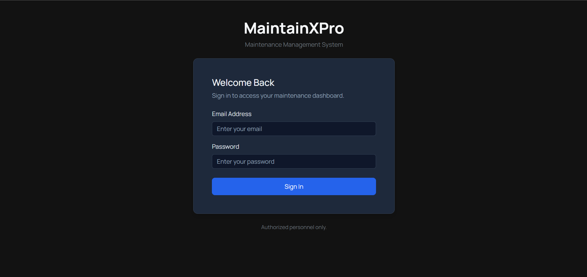
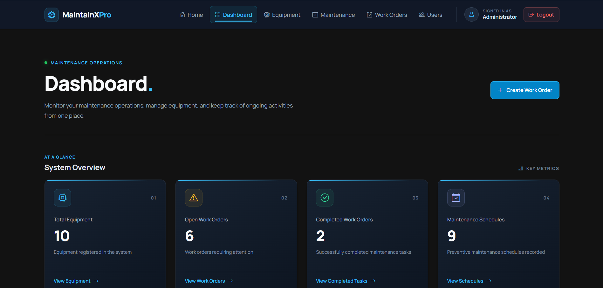
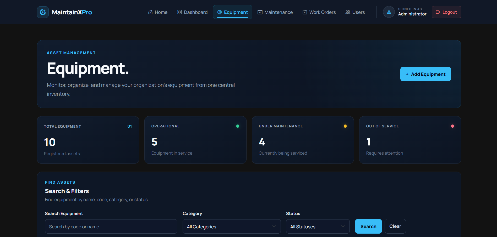
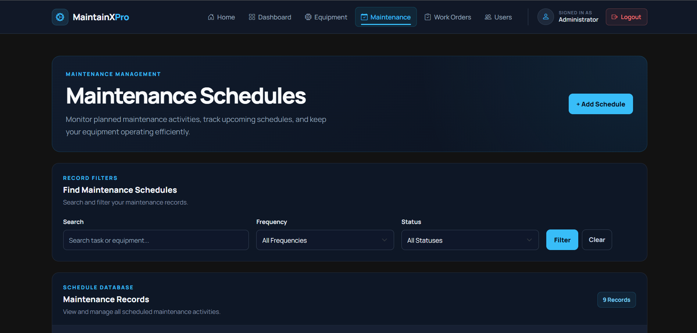
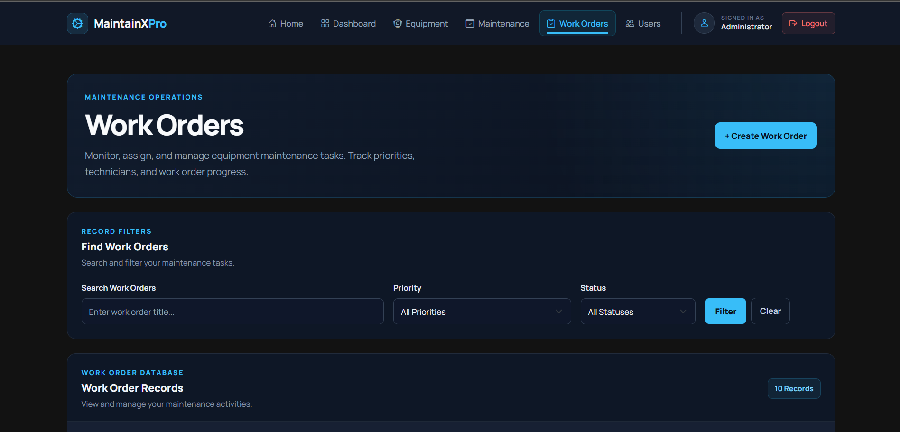
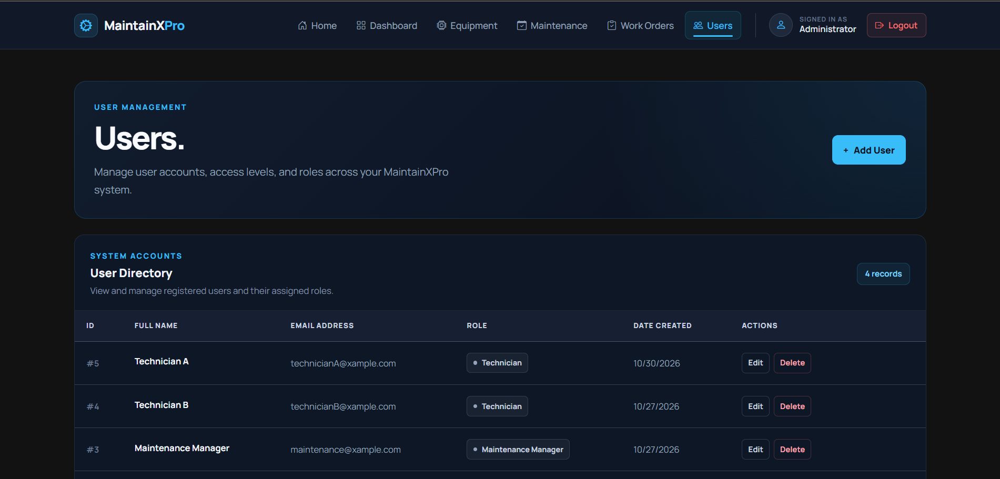

# MaintainXPro

### Maintenance Management System

MaintainXPro is a web-based Maintenance Management System designed to help organizations efficiently manage equipment, maintenance schedules, work orders, and personnel.

The system provides a centralized platform for monitoring equipment, organizing preventive maintenance activities, managing maintenance requests, and tracking work order progress.

Built with Node.js, Express.js, EJS, and PostgreSQL, MaintainXPro demonstrates the development of a full-stack web application with database integration, user authentication, and role-based access control.

**Project Status:** Active Development

## Key Features

### Dashboard

- Overview of maintenance activities.
- Equipment statistics.
- Work order monitoring.
- Maintenance schedule tracking.

### Equipment Management

- Register new equipment.
- View equipment records and details.
- Edit equipment information.
- Delete equipment records with safeguards.
- Search and filter equipment.
- Track equipment operational status.

### Maintenance Schedule Management

- Create maintenance schedules.
- View scheduled maintenance activities.
- Edit existing schedules.
- Manage preventive maintenance activities.

### Work Order Management

- Create and manage work orders.
- Assign work orders to technicians.
- Track work order priorities and statuses.
- Monitor maintenance activities.

### User Management

- Register and manage system users.
- Edit user information.
- Assign user roles.
- Manage access based on user permissions.

### Authentication and Security

- Secure user authentication.
- Password hashing.
- Role-based access control.
- Session management.
- Protected application routes.
- Environment-based database configuration.

### User Interface

- Dark-themed interface.
- Responsive layouts using Bootstrap 5.
- Consistent navigation and page layouts.
- User-friendly forms and notifications.

## Technology Stack

MaintainXPro is developed using the following technologies:

| Technology         | Purpose                               |
| ------------------ | ------------------------------------- |
| Node.js            | JavaScript runtime environment        |
| Express.js         | Backend web application framework     |
| PostgreSQL         | Relational database management system |
| node-postgres (pg) | PostgreSQL database connectivity      |
| EJS                | Server-side templating engine         |
| Bootstrap 5        | Responsive UI framework               |
| HTML5              | Web page structure                    |
| CSS3               | Styling and interface design          |
| JavaScript         | Application functionality             |
| bcrypt             | Password hashing                      |
| express-session    | Session management                    |
| connect-pg-simple  | PostgreSQL session storage            |
| dotenv             | Environment variable management       |

### Development Tools

- Visual Studio Code
- pgAdmin 4
- Git
- GitHub
- npm (Node Package Manager)

## User Roles and Permissions

MaintainXPro supports different user roles to organize maintenance activities and manage access to system features.

| User Role           | Description                                                             |
| ------------------- | ----------------------------------------------------------------------- |
| Technician          | Handles assigned maintenance work orders and maintenance activities.    |
| Maintenance Manager | Oversees maintenance operations, schedules, and work order activities.  |
| Administrator       | Manages the system, users, equipment, and overall application settings. |

### Role-Based Access Control

The application uses role-based access control (RBAC) to restrict access to features based on user roles.

This helps maintain organized workflows and ensures that users access the functionality appropriate to their responsibilities.

## Screenshots

### Login Page



### Dashboard



### Equipment Management



### Maintenance Schedules



### Work Orders



### User Management



## Demo Accounts

Visitors can explore MaintainXPro using the following demonstration accounts.

| Role                | Email                                                   | Password |
| ------------------- | ------------------------------------------------------- | -------- |
| Technician A        | [technicianA@xample.com](mailto:technicianA@xample.com) | 12345678 |
| Technician B        | [technicianB@xample.com](mailto:technicianB@xample.com) | 12345678 |
| Maintenance Manager | [maintenance@xample.com](mailto:maintenance@xample.com) | 12345678 |
| Administrator       | [admin@xample.com](mailto:admin@xample.com)             | 12345678 |

### Demo Account Information

- Each account represents a different user role.
- Available features depend on the assigned role and permissions.
- These accounts are provided exclusively for demonstration and testing purposes.

**Important:** These are public demo credentials. Do not use them for real organizational data or production administration. Access to certain administrative features may be restricted in the demonstration environment.

## Installation and Setup

Follow these instructions to run MaintainXPro on your local machine.

### Prerequisites

Make sure you have installed:

- [Node.js](https://nodejs.org/)
- [PostgreSQL](https://www.postgresql.org/)
- [Git](https://git-scm.com/)

### 1. Clone the Repository

Open your terminal and execute:

```bash
git clone https://github.com/Jayce009958/MaintainXPro.git
```

### 2. Navigate to the Project Directory

```bash
cd MaintainXPro
```

### 3. Install Dependencies

```bash
npm install
```

### 4. Configure the Database

Create a PostgreSQL database named:

```text
maintainxpro
```

The required database tables must be configured before running the application.

### 5. Configure Environment Variables

Create a `.env` file in the project root directory and configure your database connection credentials.

Refer to the Environment Variables section below.

### 6. Start the Application

Run:

```bash
node index.js
```

Open your browser and visit:

```text
http://localhost:3000
```

**Note:** Database credentials and other sensitive configuration values should never be committed to GitHub.

## Environment Variables

MaintainXPro uses environment variables to securely manage database connection settings.

Create a `.env` file in the root directory of the project.

Add the following configuration:

```env
DB_USER=your_postgresql_username
DB_HOST=localhost
DB_NAME=maintainxpro
DB_PASSWORD=your_postgresql_password
DB_PORT=5432
```

### Configuration Details

| Variable      | Description              |
| ------------- | ------------------------ |
| `DB_USER`     | PostgreSQL username      |
| `DB_HOST`     | Database server hostname |
| `DB_NAME`     | PostgreSQL database name |
| `DB_PASSWORD` | PostgreSQL password      |
| `DB_PORT`     | PostgreSQL server port   |

Replace the example values with your own PostgreSQL credentials.

**Security Notice:**

- Never upload your `.env` file to GitHub.
- Never expose actual database credentials.
- The `.env` file is excluded through `.gitignore`.
- Use separate environment variables for production deployment.

## License

No open-source license has been specified for this project.

MaintainXPro is a portfolio project developed for educational and demonstration purposes. All rights are reserved by the project author.
